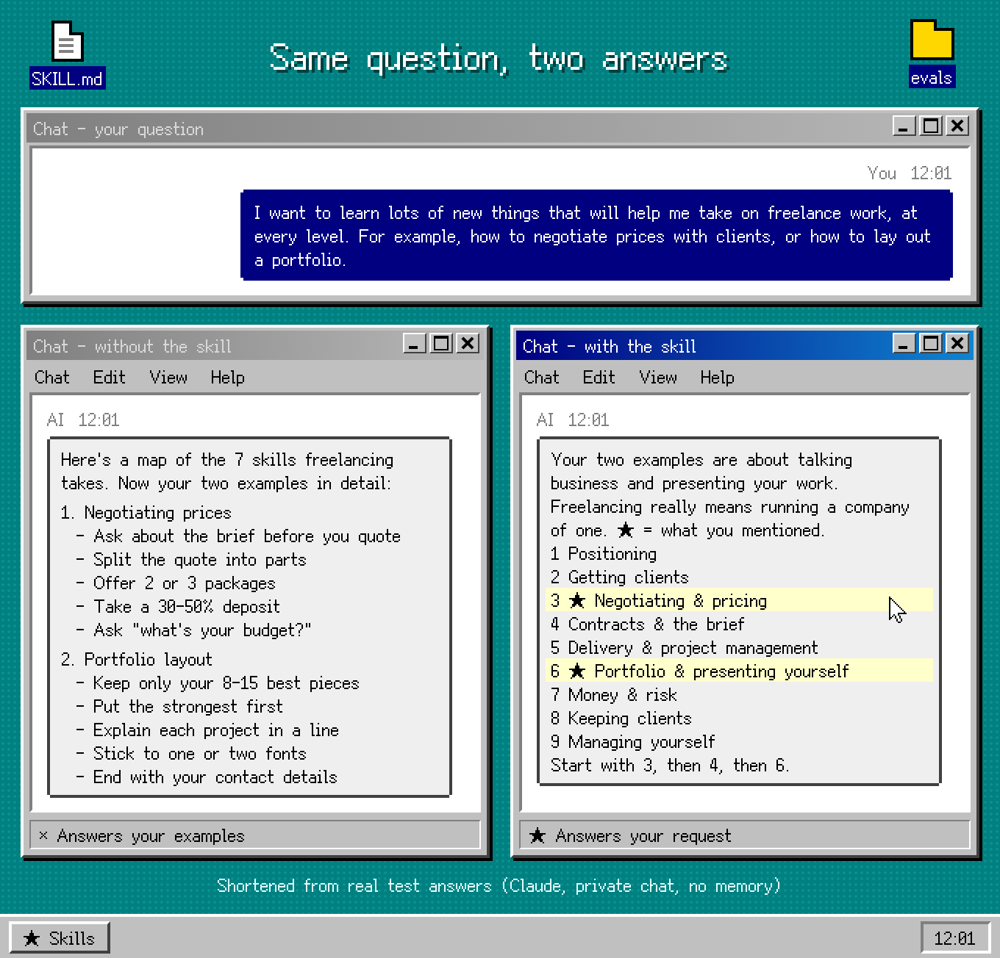

# examples-are-not-requirements

English | [中文](README.zh.md)

An agent skill that helps AI assistants stop treating your examples as a complete list.

Have you ever given an agent an example, only for it to take that example as the actual requirement and run with it? This skill is meant to help with that.

It targets two failures:

- **Only the examples get answered:** you write a long message about what you want, and somewhere in the middle you drop in a couple of examples to show what you mean. The assistant then answers the examples in detail and never gets to your actual request.
- **It adds more, but your examples still come first by default:** the assistant does add other things, yet your examples are still called "the core", placed first and given the most detail, while the added items get only a name. As if the examples you mentioned in passing were the thing you wanted most.

With this skill, it first tells you in one sentence which categories it thinks your examples point to, then works at that level: it keeps your examples, adds relevant things you didn't mention, links the categories together, and labels which items are yours and which it added. In a plan, order and detail follow your goal: your examples are not put first just because you gave them, and not pushed to the back either.

## Before and after



**You:** "I want to learn lots of new things that will help me take on freelance work, at every level. For example, how to negotiate prices with clients, or how to lay out a portfolio so it looks better."

**Without the skill:** a short map of the skills freelancing takes, then two long sections of tips, one on negotiating prices and one on portfolio layout. About 60% of the answer explains your two examples (from an earlier test; see the limits below).

**With the skill:**

> Your two examples are about how to talk business and how to present your work. Taking on freelance work really means running a one-person company, so here it is layer by layer. ★ marks what you mentioned.
>
> 1. Positioning: what you sell and to whom
> 2. Getting clients
> 3. ★ Negotiating and pricing
> 4. Contracts and confirming the brief
> 5. Delivery and project management
> 6. ★ Portfolio and presenting yourself
> 7. Money and risk
> 8. Keeping clients and getting referrals
> 9. Managing yourself
>
> If you want an order: 3, then 4, then 6. Pricing and contracts decide whether you lose money; the portfolio decides whether you get work.

(Shortened from a real test answer, which also had a few points under each layer. See [Test results](#test-results).)

### Second example: it adds more, but the examples still come first


**You:** "I want to learn practical skills that improve my quality of life, such as photography and cooking. Please make me a full learning plan." (asked in Chinese)

**Without the skill:** it opens with "photography and cooking are the focus; the other skills will be woven in." Its table labels photography and cooking "main skills" and money, exercise and tidying "side skills"; photography and cooking then each get a full month-by-month section, while each side skill gets a sentence or two.

**With v1.0:** it names the categories and labels "your examples / what I added", and adds eight skills. But it says "I'll put your two examples at the core" and ends with "photography and cooking always stay at the front"; the added skills sit in a "why it's worth learning" table, mostly with no way to start.

**With v1.1:** "So the plan below isn't just these two; it brings in all the practical skills that clearly improve your life." Its first stage puts cooking and photography next to money and first aid, each with a first step, such as "install a budgeting app today" or "book a first-aid course". The examples still start early, for reasons tied to your goal: one is used every day, the other is something you already want to do.

(All three are real answers from the environment-checked tests, translated from Chinese. Originals: round-1/883.md, round-1/519.md and round-4/935.md in [`evals/clean-runs/`](evals/clean-runs/).)

## Test results

### v1.1.0 (environment-checked tests)

Run in a chat with memory, personal preferences and the author's other skills all switched off. Before every round, the runner and a sub-agent reported what they could see about the user and found nothing beyond the account email; this lowers the risk of hidden influences but cannot rule it out. Each answer comes from a fresh sub-agent with the skill pasted in. All raw answers are published in [`evals/clean-runs/`](evals/clean-runs/); details in [`evals/RESULTS.md`](evals/RESULTS.md).

Main message: "I want to learn practical skills that improve my quality of life, such as photography and cooking. Please make me a full learning plan." (asked in Chinese)

- **Without the skill**, 5 of 5 answers built the plan around the two examples (calling them "core" or "the main line", or making them the only focus of the first stage). This is an observation, not automatically a failure; whether it is reasonable depends on the request.
- **v1.0.0** named the category and labeled the items 5 of 5, but still built the plan around the examples in 3 of 5.
- **v1.1.0 itself**, a targeted regression check on the final wording (7 runs): the main message again named categories, labeled items and gave every planned item a concrete start, 3 of 3; a named channel topic (French cooking; smartphone photography for retired people) stayed on that topic, 2 of 2; a named reminder (Case 1 and a new one) stayed on the named tool and was honest about not carrying reminders into a new chat, 2 of 2. This found none of the target problems, but it is too small to show the version is stable.
- **The draft before v1.1.0, on new examples** (healthy habits; workplace skills): named the categories, labeled the items and explained the order by the goal in 6 of 6.
- **The same draft, on cases that must not change**: a closed list, a format to copy, real plans and a podcast question all behaved as intended, 8 of 8.

Honest limits:
- Five runs per group at most, mostly on one message.
- The results were counted by the AI assistant that helped write the skill, which knew which answer came from which version. OpenAI Codex then rechecked the counts and corrected several; the numbers here are the corrected ones. Everything is published so you can recount it.
- The skill was pasted into each run. This shows how well a model follows it once loaded, not whether it triggers by itself or how it behaves when the agent reads only its description.

### v1.0.0 (earlier tests)

These were run with the author's saved personal preferences still on, which included a rule about examples, and their raw answers were not kept, so they cannot be checked independently. Treat them as a historical record. The full cases and expected behaviour are in [`evals/evals.json`](evals/evals.json).

- **Long message with examples buried inside** (the main problem this skill solves), tested with two different messages:
  - A real message from the author, kept private: without the skill about 1.5 of 5 criteria met; with it, **5 of 5 in 2 out of 2 runs**.
  - The freelance message above: without the skill about 2 of 5; with it, **5 of 5 in 4 out of 4 runs**. Saved personal preferences, which included a rule about examples, stayed on for all these runs, so "without the skill" means preferences alone.
- **Short one-line requests with examples**: modern models already expand these fairly well on their own. The visible change from the skill is clearer structure and explicit labels for your items.
- **Examples that are real plans** ("I want to do a few new things, like opening a coffee shop or learning street photography. How do I start?"): with the skill on, both plans are answered concretely first, and extras go in a separate section at the end.
- **On another model:** also tested in OpenAI Codex. The long-message case went from about 3.5 of 5 to 5 of 5, and the real-plans and closed-list cases passed.
- **Cases where it should not expand** (a closed list, no examples, a format to copy, a test case): 4 of 4 handled correctly with the skill on. It did not make any of them worse.

Honest limits: each case was run only a few times, and the answers were graded by the same AI assistant that helped write the skill. On very simple requests the assistant sometimes skips loading the skill and works from its description alone.

## When it triggers

- Example markers in English or Chinese: "for example", "for instance", "e.g.", "such as", "things like", "like" (when it introduces examples), "比如", "比如说", "例如", "举个例子", "打个比方", "像……这种", and similar.
- A single named thing, even with no marker words, when the message clearly shows it stands for a whole category. A single named topic with no such sign (e.g. "make a channel about French cooking for English speakers") is treated as your chosen topic.

## When it does not trigger

- An explicit closed list: "just these", "only these", "do exactly this", "nothing else".
- A request with no examples at all.
- Examples that show a format or style to copy, not content to expand.
- Test cases or exact specs (e.g. "input 3 should return 9"). These are treated as hard requirements.

## What it guards against

- **Answering the examples instead of the request:** the examples take over the answer, and what you actually asked for never gets answered. This is the most common failure, and the main one this skill targets.
- **Adding more, but your examples still come first by default:** other things are added, but the examples are called "the core", placed first and given the most detail, while the added items get only a name, and nothing in your goal explains why. The opposite is also wrong: pushing your examples to the back just to look unbiased.
- **Too little:** handing your examples back as the whole answer, or stopping after doing exactly the items you named.
- **Too much:** burying your request under a flood of additions, drifting outside the category, or replacing your examples with the assistant's own.

## How to know it's working

- The answer opens with one sentence naming the categories it understood, e.g. "Got it: you want to learn skills at the level of business and video creation." If that sentence is wrong, correct it right there.
- Your examples are named, but they do not take over the answer just because you gave them; how much detail each item gets follows your goal.
- If your examples are things you actually plan to do, each one gets a concrete answer first, and extras come in a separate section at the end.
- Your items and the assistant's are labeled separately, e.g. "Your examples: …" and "Added: …".
- In a plan, the order follows your goal. Your examples are not automatically put first, and not pushed to the end either, and every item gets at least one concrete first step.
- When you say "just these" or "only these", nothing extra is added.

## Tradeoffs

- Answers get a little longer, because the assistant adds a few items you didn't ask for.
- If you actually wanted a deep dive into one of your examples, you'll need to ask for it as a follow-up. The assistant usually offers this at the end.
- The assistant decides what the category is. If it guesses wrong, the added items will feel off. Tell it the category, or say "just these" to turn expansion off for that request.

## Installation

The quickest way, if you have Node.js installed:

```
npx skills add reshiramsq18-alt/examples-are-not-requirements
```

It asks which of your AI tools to install it for and copies the skill into the right folder.

To install by hand instead:

The skill is a single folder containing `SKILL.md`:

```
examples-are-not-requirements/
└── SKILL.md
```

Copy the `examples-are-not-requirements` folder into the skills directory of any agent that supports `SKILL.md` skills. For Claude Code, that is `~/.claude/skills/` (all projects) or `.claude/skills/` inside a project.

For OpenAI Codex, you can ask its built-in skill installer to install from this repository, using the path `examples-are-not-requirements`, then restart Codex:

```
$skill-installer install the skill from GitHub repo reshiramsq18-alt/examples-are-not-requirements, path examples-are-not-requirements
```

## Changes

- **1.1.0:** decides from the whole message whether examples are real plans; does not make your examples central just because you named them; sets order and depth by your goal, without pushing your examples to the back; gives every item in a plan a concrete first step; treats a single named topic or tool as your choice unless the message shows it stands for more. Retested in an environment-checked setup, including a 7-run regression check on the final wording (see above).
- **1.0.0:** first release.

## License

[MIT](LICENSE)
