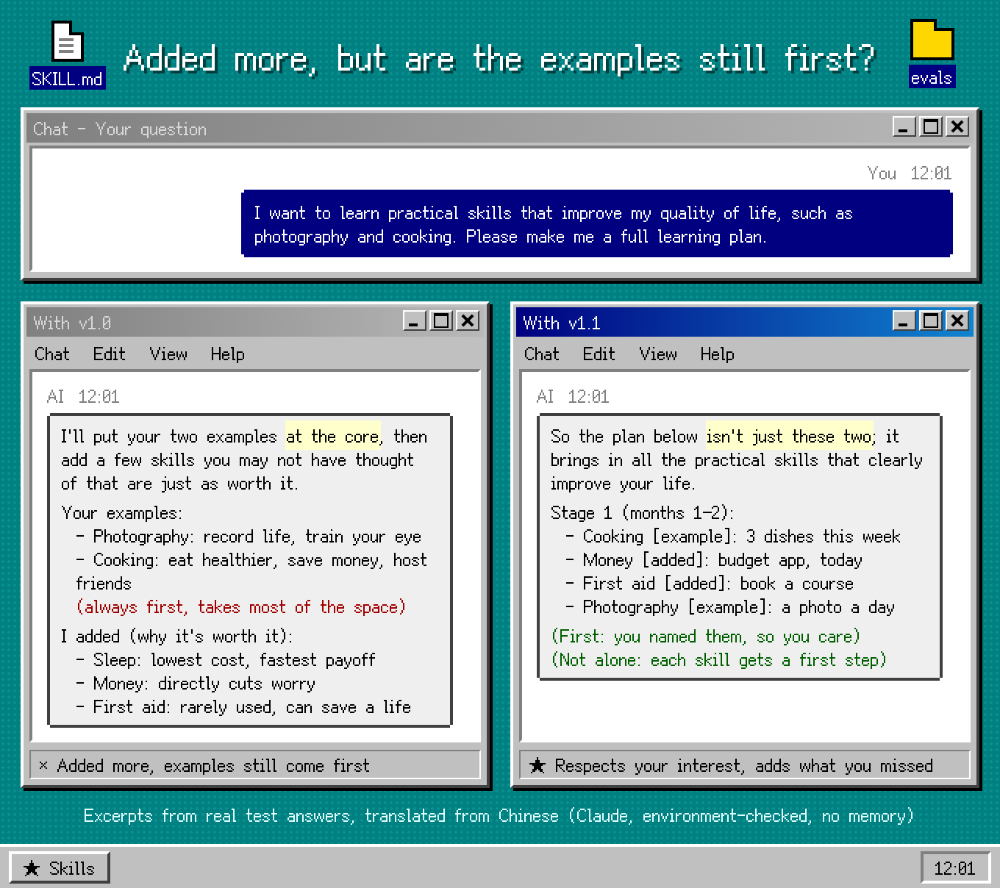

# examples-are-not-requirements

English | [中文](README.zh.md)

An agent skill that helps AI assistants understand your examples, without treating them as a complete list or giving them automatic priority.

Ever given an AI a couple of examples, only to watch it focus almost entirely on those examples?

## Why I built this

I often drop two examples into the middle of a long message, just to show what kind of thing I mean. The AI kept treating those two examples as the question and writing at length about them, when what I actually wanted to know went beyond those two. Later it learned to add other things, but the examples were still treated as the main point. I wrote this skill to fix both problems.

## What it fixes

It targets two failures:

- **Only the examples get answered:** you write a long message and drop in a couple of examples to show what you mean. The assistant answers the examples in detail and never gets to your actual request.
- **The examples automatically become the focus:** the assistant does add other things, but your examples are still called "the core" and given the most detail, while the added items get only a name, and nothing in your goal explains why.

With this skill, the assistant first tells you in one sentence which categories it thinks your examples point to, then works at that level: it keeps your examples, adds relevant things you didn't mention, and labels which items are yours and which it added. In a plan, order and detail follow your goal. An example you thought of first shows interest, so it can come early, but it does not take over the plan.


(The image above is from an earlier test and shows the first failure.)

## An example

**You:** "I want to learn practical skills that improve my quality of life, such as photography and cooking. Please make me a full learning plan." (asked in Chinese)

**Without the skill:** it opens with "photography and cooking are the focus; the other skills will be woven in." Its table labels photography and cooking "main skills" and money, exercise and tidying "side skills"; photography and cooking then each get a full month-by-month section, while each side skill gets a sentence or two.

**With the skill:** it first names the categories it understood, then puts the added skills and your examples into the same plan. Its first stage (excerpt, translated):

> | Skill | First step |
> |---|---|
> | Cooking [your example] | Learn 3 home dishes this week: a stir-fry, a soup and a staple; make each 3 times |
> | Money [added] | Install a budgeting app today and log every expense for 30 days, without changing anything yet |
> | First aid [added] | Book a first-aid course with the Red Cross or a local group |
> | Photography [your example] | Take one photo a day on your phone for 30 days, practicing one theme, such as light |

Photography and cooking still start in the first stage, but the reason given is "one you use every day, the other keeps you motivated"; the added skills are in the plan too, not just names.

(Both come from real tests. Originals: round-1/883.md and round-4/935.md in [`evals/clean-runs/`](evals/clean-runs/).)

## Installation

The quickest way, if you have Node.js installed:

```
npx skills add reshiramsq18-alt/examples-are-not-requirements
```

It asks which of your AI tools to install it for and copies the skill into the right folder.

To install by hand instead:

The skill is a single folder containing `SKILL.md`:

```
examples-are-not-requirements/
└── SKILL.md
```

Copy the `examples-are-not-requirements` folder into the skills directory of any agent that supports `SKILL.md` skills. For Claude Code, that is `~/.claude/skills/` (all projects) or `.claude/skills/` inside a project.

For OpenAI Codex, you can ask its built-in skill installer to install from this repository, using the path `examples-are-not-requirements`, then restart Codex:

```
$skill-installer install the skill from GitHub repo reshiramsq18-alt/examples-are-not-requirements, path examples-are-not-requirements
```

## When it triggers

- Example markers in English or Chinese: "for example", "for instance", "e.g.", "such as", "things like", "like" (when it introduces examples), "比如", "比如说", "例如", "举个例子", "打个比方", "像……这种", and similar.
- A single named thing, even with no marker words, when the message clearly shows it stands for a whole category. A single named topic with no such sign (e.g. "make a channel about French cooking for English speakers") is treated as your chosen topic.

## When it does not trigger

- An explicit closed list: "just these", "only these", "do exactly this", "nothing else".
- A request with no examples at all.
- Examples that show a format or style to copy, not content to expand.
- Test cases or exact specs (e.g. "input 3 should return 9"). These are treated as hard requirements.

## What using it looks like

- The answer opens with one sentence naming the categories it understood. If that sentence is wrong, correct it right there.
- Your items and the assistant's are labeled separately, e.g. "Your examples: …" and "Added: …".
- Your examples are named, but they do not take over the answer just because you gave them. In a plan, order and detail follow your goal, and planned items get a concrete starting action.
- If your examples are things you actually plan to do, each one gets a concrete answer first, and extras come in a separate section at the end.
- When you say "just these" or "only these", nothing extra is added.

## Limits and tradeoffs

- Answers get a little longer, because the assistant adds a few items you didn't ask for.
- The assistant decides what the category is. If it guesses wrong, the added items will feel off. Tell it the category, or say "just these".
- If your examples really are your main focus, say so. It should follow that, rather than pushing them back.
- The opposite counts as a failure too: pushing your examples to the end just to look unbiased.

## Test summary

The final version (v1.1.0) was tested in a chat with memory, personal preferences and the author's other skills switched off. Before each round there was an environment check: the runner and a sub-agent reported what they could see about the user and found nothing beyond the account email the system adds automatically. This lowers the risk of hidden influences but cannot rule it out.

- **Main message, without the skill:** 5 of 5 answers built the plan around the two examples.
- **Main message, v1.1.0:** 3 of 3 named the categories, labeled the items and put the added skills into the same plan; none called the examples the core. In one answer (935), one "first step" was a goal ("save three months of living costs as an emergency fund"), not a concrete starting action.
- **A single named topic or tool, v1.1.0:** both channel requests (French cooking; smartphone photography for retired people) stayed on the named topic; both reminder requests reminded only about the named tool and said honestly that they cannot carry a reminder into a new chat. One also offered reminders the user had not asked for, recorded as an observation.
- **The draft just before v1.1.0** (a few wording changes apart): on two new sets of examples (healthy habits; workplace skills) it named categories, labeled items and explained the order by the goal in 6 of 6; on a closed list, a format to copy, real plans and a podcast question it behaved as intended in 8 of 8.

Limits:
- Five runs per group at most; the final version ran the main message only 3 times, so this does not show it is stable.
- The counting was done by the AI assistant that helped write the skill, which knew which answer came from which version. OpenAI Codex rechecked the counts for rounds 1–3 and corrected several; it only reviewed the documents for round 4, so it does not vouch for every number here. All raw answers are published so you can recount them.
- The skill was pasted into each run. This shows how well a model follows it once loaded, not whether it triggers by itself or how it behaves from the description alone.

The full test process, counts for every round and the historical v1.0.0 tests are in [`evals/RESULTS.md`](evals/RESULTS.md).

## Changes

- **1.1.0:** order and detail follow your goal; an example you thought of first can come early but does not take over; planned items get a concrete starting action; decides from the whole message whether examples are real plans; treats a single named topic or tool as your chosen target unless the message shows it stands for more.
- **1.0.0:** first release.

<details>
<summary>See a v1.0 vs v1.1 comparison</summary>



On the same question, v1.0 already named the categories, labeled the items and added eight skills, but it said "I'll put your two examples at the core" and ended with "photography and cooking always stay at the front". v1.1 still starts photography and cooking early, but for reasons tied to your goal and interest, with the added skills in the same stage. Originals: round-1/519.md and round-4/935.md.

</details>

## License

[MIT](LICENSE)
