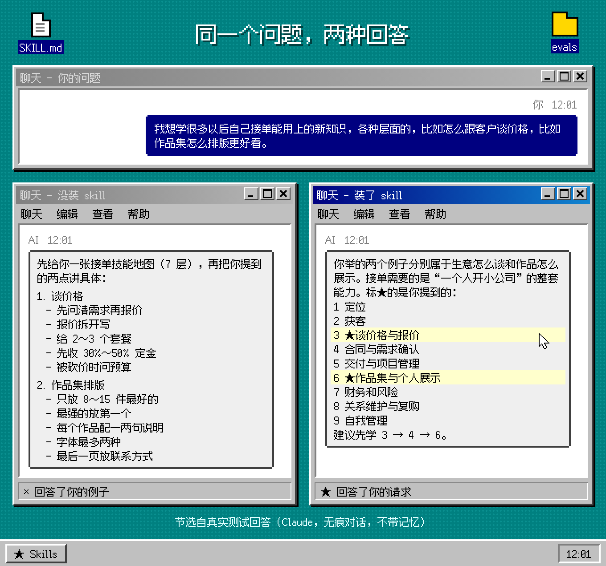
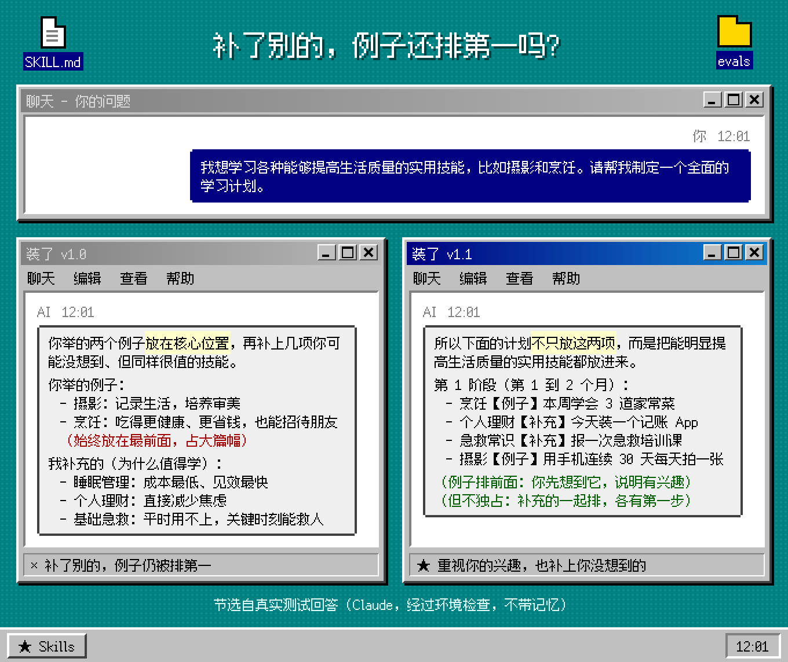

# examples-are-not-requirements（举例 ≠ 需求）

[English](README.md) | 中文

一个 agent skill：帮 AI 理解你举的例子，既不把它们当成完整清单，也不自动给它们最高优先级。

你有没有遇到过这种情况：给 AI 举了个例子，它就把这个例子当成了全部要求，一头扎进去了？

## 为什么做这个

我经常在一大段对话中间随手举两个例子，说明我想要的是哪一类东西。结果 AI 总是把这两个例子当成题目写下长篇大论，可是我明明真正想要知道的不止这两个例子。后来它学会了补充别的内容，可例子还是会被当成重点。这个 skill 就是为了解决这两个问题而写的：

- **只围着例子转**：回答被例子占满，你真正问的事没人回答。
- **例子自动成了重点**：补了别的内容，例子还是被叫成"核心"、写得最细，补充的只列个名字。

## 核心功能：不再只围着例子转

装了这个 skill 以后，它会先用一句话说出它理解的是哪几个层面，然后在这些层面上展开：保留你的例子，补上你没提到的相关内容，并且标清楚哪些是你说的、哪些是它加的。



（上图来自早期测试。）

## v1.1 的优化：例子不再自动成为重点

v1.0 已经会补充别的内容，但你的例子还是常被当成核心、写得最细。v1.1 让先后和详略按你的目标走：你先想到的例子说明你有兴趣，可以排在前面，但不会独占；补充的技能也排进同一个计划，给出具体的起步动作。



（左边是 v1.0，右边是 v1.1，都来自经过环境检查的测试，原文见 [`evals/clean-runs/`](evals/clean-runs/) 里的 round-1/519.md 和 round-4/935.md。）

## 安装

最快的方法（电脑上需要装有 Node.js）：

```
npx skills add reshiramsq18-alt/examples-are-not-requirements
```

它会问你要装给哪些 AI 工具，然后自动把 skill 放到对应的文件夹里。

也可以手动安装：

这个 skill 就是一个文件夹，里面只有一个 `SKILL.md`：

```
examples-are-not-requirements/
└── SKILL.md
```

把 `examples-are-not-requirements` 文件夹复制到任何支持 `SKILL.md` 的 agent 的 skills 目录里。Claude Code 的位置是 `~/.claude/skills/`（对所有项目生效），或者项目里的 `.claude/skills/`。

用 OpenAI Codex 的话，可以让它自带的 skill 安装工具直接从这个仓库装，路径填 `examples-are-not-requirements`，装完重启 Codex：

```
$skill-installer 从 GitHub 安装这个 skill：仓库 reshiramsq18-alt/examples-are-not-requirements，路径 examples-are-not-requirements
```

`SKILL.md` 本身是英文写的，中文用户照样可以用。里面已经包含中文的触发词。

## 什么时候会触发

- 中文或英文里的举例词："比如"、"比如说"、"例如"、"举个例子"、"打个比方"、"像……这种"，"for example"、"for instance"、"e.g."、"such as"、"things like"、"like"（用来引出例子时），以及类似的说法。
- 只点名了一个具体的东西，但上下文清楚说明它代表一整类，即使没有用举例词。如果没有这样的迹象（比如"给英语观众做一个讲法国菜的频道"），就当作你选定的主题。

## 什么时候不会触发

- 明确说了只要这些："就要这几个"、"别的不用"、"just these"、"only these"、"do exactly this"。
- 请求里一个例子都没有。
- 例子是让 AI 照着模仿的格式或风格，不是要扩展的内容。
- 例子是测试用例或者精确规格（比如"输入 3 应该返回 9"）。这类会被当成必须满足的硬性要求。

## 用起来是什么样

- 回答开头会先用一句话说出它理解的层面。如果这句话说错了，当场纠正它就行。
- 你的和 AI 补的会分开标，比如"你的例子：……"和"补充：……"。
- 你的例子会被点到，但不会只因为是你举的就占掉回答的主体。做计划时，先后和详略跟着你的目标走，计划里的项目都会给具体的起步动作。
- 如果你的例子是自己真打算去做的事，每件事都会先得到具体回答，补充单独放在最后一节。
- 你说"就要这几个"或"别的不用"时，它什么都不加。

## 局限和取舍

- 回答会变长一点，因为 AI 会补几个你没要的东西。
- 类别由 AI 来判断。如果它猜错了，补的东西会让你觉得不对劲。这时直接告诉它是哪一类，或者说"就要这几个"。
- 如果你的例子就是你的重点，直接说清楚，它会按你的意图来，不会硬把它们往后放。
- 反过来也一样：为了显得不偏心，故意把你的例子压到最后，也算这个 skill 没做好。

## 测试摘要

最终版（v1.1.0）是在一个关掉了记忆、个人偏好和作者其他 skill 的对话里测的。每一轮开始前都做了环境检查：跑测试的对话和一个子代理报告自己能看到的用户信息，除了系统自动带上的邮箱，什么都没看到。这能降低隐藏影响的风险，但不能完全排除。

- **主测试题，不装 skill**：5 次都围着两个例子做计划。
- **主测试题，v1.1.0**：3 次都先说类别、标出来源，把补充的技能排进同一个计划，没有一次把例子当成核心。其中 1 次（935）有一项"第一步"写成了目标（"存下 3 个月的生活费作为应急金"），不算具体的起步动作。
- **只点名一个主题或工具，v1.1.0**：两个频道题（法国菜、给退休老人讲手机摄影）都没有越出点名的主题；两个提醒题都只提醒指定的工具，也如实说明了在新对话里提醒不了。其中一次额外答应了用户没要的提醒，记为观察。
- **最终版之前的一版**（和最终版只差几处措辞）：换了两批新例子（健康习惯、职场能力），6 次都先说类别、标出来源、用目标解释顺序；写死的清单、照着模仿的格式、真实计划、播客提问 4 种情况，8 次都按预期处理。

局限：
- 每组最多跑 5 次，最终版主测试题只跑了 3 次，不能说明已经稳定。
- 计数的是参与写这个 skill 的 AI 助手，它知道哪份回答来自哪个版本。OpenAI Codex 核对了前三轮的计数并改正了几处，第四轮只看过文档，不代表它认可这里所有的数字。所有原始回答都公开了，你可以自己重新数。
- 测试时 skill 是直接贴给模型的。这能说明模型读到 skill 以后照不照做，不能说明它会不会自己触发，也不能说明只看 description 时的表现。

全部测试过程、每一轮的计数和 v1.0.0 的历史测试，见 [`evals/RESULTS.md`](evals/RESULTS.md)。

## 更新记录

- **1.1.0**：先后和详略按你的目标定，你先想到的例子可以排在前面，但不会独占；计划里的项目都给具体的起步动作；根据整段话判断例子是不是真实计划；你只点名一个主题或工具时，除非上下文说明它代表更多，否则当作你选定的目标。
- **1.0.0**：第一次发布。

## 许可证

[MIT](LICENSE)
